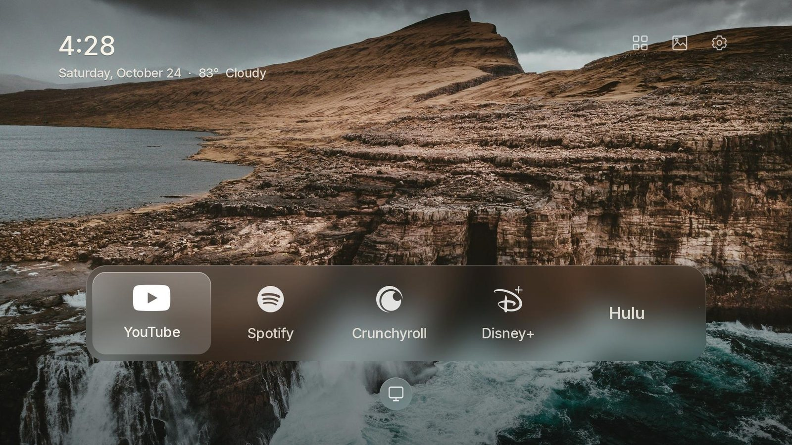
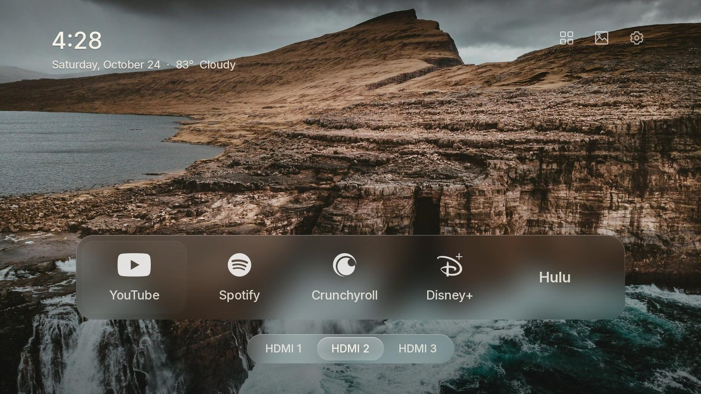
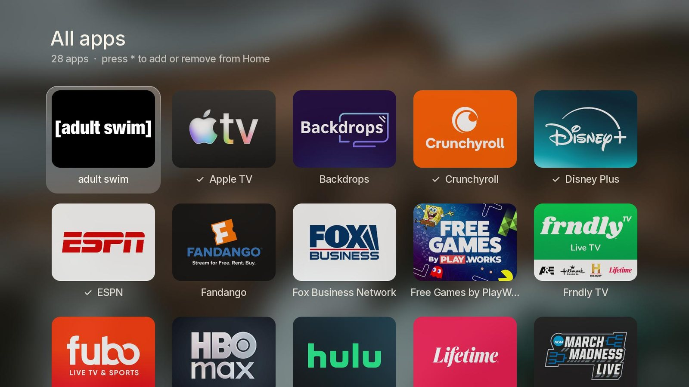
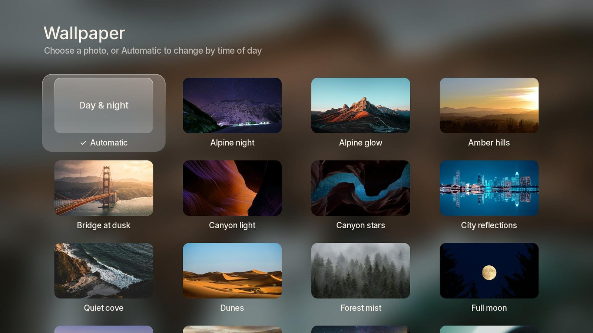
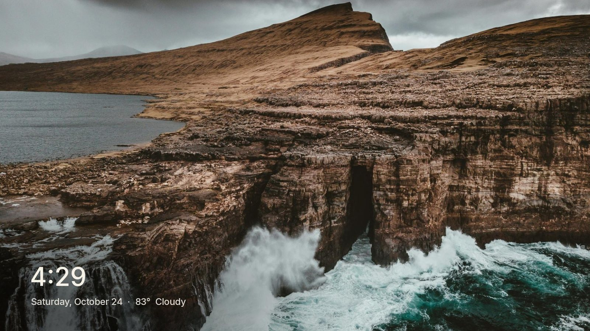
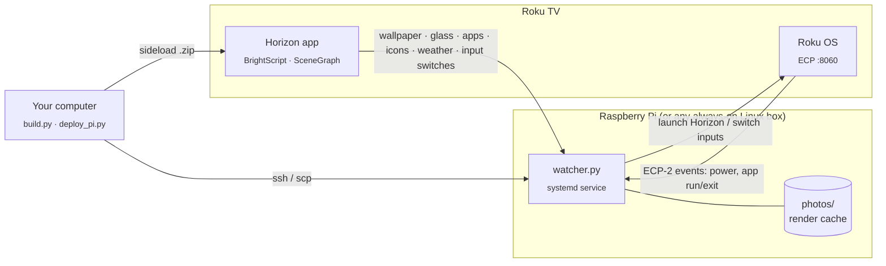

<div align="center">

# Horizon

**A calm, photo‑first home screen for Roku TVs.**
Liquid‑glass dock · day & night wallpapers · one‑press HDMI inputs · a Frame‑style screensaver




</div>

Horizon replaces the Roku home screen with something closer to Apple TV or a Samsung Frame: a full‑screen photograph, a frosted glass dock of your apps, the time and weather, and nothing else. It's a sideloaded Roku app plus a small companion service on a Raspberry Pi that brings it back whenever you turn the TV on or leave an app.

Inspired by [CleanFrame](https://github.com/nthnclrk/CleanFrame), which does the same for Samsung's Frame TVs.

<table>
  <tr>
    <td width="50%"><br><sub><b>Inputs.</b> Press ▼ and the TV icon stretches into a glass pill of HDMI inputs.</sub></td>
    <td width="50%"><br><sub><b>All apps.</b> Every installed app; press ✱ to add it to Home or take it off.</sub></td>
  </tr>
  <tr>
    <td><br><sub><b>Wallpaper.</b> Automatic (brighter by day, darker at night) or pin any photo.</sub></td>
    <td><br><sub><b>Screensaver.</b> Crossfading photos with the time and weather, from the launcher or as Roku's screensaver.</sub></td>
  </tr>
</table>

## Features

- **Liquid glass, on a Roku.** The TV can't blur in real time, so the companion pre‑renders each glass surface from the exact patch of photo behind it. A focus plate glides between apps, the inputs pill stretches open with a little overshoot, and the dock fades into the glass at its edges.
- **Comes back by itself.** Turn the TV on, leave an app, or leave an HDMI input and Horizon opens again. Press Home *inside* Horizon and you stay on Roku's home screen, so its settings are always one press away.
- **Day & night wallpapers.** Photos are sorted by brightness. Brighter ones show while the sun is up (using local sunrise and sunset), darker ones at night. Change on every open, every 15 minutes or hourly, or pin a favourite.
- **HDMI inputs one press away** in a glass pill under the dock. It remembers the last one you used.
- **Your apps, your order.** Monochrome marks for well‑known services, large type for the rest. Rearrange or remove right on the dock (✱), add from All apps (✱). Saved on the TV.
- **A screensaver** that shares the same photos and type. It starts by itself after your Roku screensaver wait time while Horizon is open, or on demand from the top‑right controls.
- **Clock & weather** (Open‑Meteo; no API key).

## How it works



| Piece | Role |
|---|---|
| **Roku app** (`app/`) | The home screen, All apps, Settings and the screensaver. Opens apps itself with `roAppManager.LaunchApp`. |
| **Watcher** (`watcher.py`, `media.py`, `roku_ecp.py`) | Listens to the TV's events and reopens Horizon; switches HDMI inputs (the TV won't let an app do that itself); serves photos, pre‑rendered glass, the app list, icons and weather. |
| **Build** (`build.py`) | Renders marks, plates and fallback glass, packages the app and sideloads it in developer mode. |

Why the Pi? Roku apps can't run in the background or intercept the Home button, and the TV refuses control requests coming from itself. A tiny service elsewhere on the network can do both. All the details, and the undocumented Roku behaviour this relies on, are in [docs/DEVELOPMENT.md](docs/DEVELOPMENT.md).

## What you need

- A **Roku TV** (built on a Hisense 6‑Series, Roku OS 15.3) on your home network.
- A **Raspberry Pi** or any always‑on Debian‑based machine with Python 3.10+ (Raspberry Pi OS Bookworm/Trixie is ideal). It uses ~100 MB RAM and is idle almost all the time.
- A computer with **Python 3.10+**, `ssh`/`scp` and `curl`, to build and deploy.

## Setup

**1. Turn on developer mode on the TV.** On the remote press **Home ×3, Up ×2, Right, Left, Right, Left, Right**, accept the agreement and set a password. The TV restarts. Give it a fixed IP in your router (DHCP reservation).

**2. Get the code and configure it.**

```bash
git clone https://github.com/braydenhand/horizon-roku.git
cd horizon-roku
python -m venv .venv && . .venv/bin/activate      # Windows: .venv\Scripts\activate
pip install -r requirements.txt
cp config.example.json config.json                 # then edit it
```

`config.json` (never committed):

| Key | Meaning |
|---|---|
| `tv` | TV's IP address |
| `dev_user`, `dev_password` | Developer‑mode login (user is `rokudev`) |
| `pi.ssh` / `pi.address` / `pi.port` / `pi.dir` | How to reach the Pi, the LAN address the watcher listens on (keep it on your LAN), its port, and its folder in the Pi user's home |
| `weather` | `latitude`, `longitude`, `unit` (`fahrenheit` or `celsius`) |

**3. Set up the Pi.** Make sure `ssh <pi.ssh>` works without a password (key‑based), then:

```bash
python deploy_pi.py --install     # apt packages, code, config, systemd service
python tools/add_photos.py ~/Pictures/wallpapers/*.jpg
```

**4. Build and install the Roku app.**

```bash
python build.py
```

That's it. Turn the TV off and on, and Horizon should open.

## Using it

✱ is the remote's Options key (`*`).

| Where | Keys |
|---|---|
| **Dock** | ◀ ▶ move · **OK** open · **▼** inputs · **▲** top‑right controls · **✱** pick the app up to move it |
| **Moving an app** | ◀ ▶ carry it · **OK** place · **▼** remove from Home |
| **Inputs pill** | ◀ ▶ choose · **OK** switch · **▲** / **Back** close |
| **Top‑right** | All apps · Screensaver · Settings |
| **All apps** | arrows · **OK** open · **✱** add to / remove from Home · **Back** close |
| **Settings** | Wallpaper (Automatic or a photo) · Change photo (each open / 15 min / hourly) |
| **Anywhere** | Roku's **Home** button: from an app or input, Horizon returns; from Horizon, you stay on Roku's home screen |

## Customising

- **Default dock, names and marks:** `launcher.json`. Marks are white SVGs in `assets/marks/`; apps without one show their name. Rebuild with `python build.py`.
- **Inputs in the pill:** `launcher.json` → `inputs` (`tvinput.hdmi1`…, `tvinput.dtv` for Live TV). Rename them ("PS5") with `label`.
- **Photos:** `python tools/add_photos.py photo.jpg[=Title] …` resizes to ≤ 3840 px, names, credits (Unsplash downloads are credited automatically) and uploads. Landscape photos with calm areas top‑left (clock) and along the bottom (dock) look best.
- **Launch screen and offline fallback photo:** put a JPEG in `wallpapers/` (otherwise `assets/wallpapers/default.jpg`) and rebuild.
- **Look and feel:** geometry lives in one place, the top of `build.py`, and reaches the app through `data/apps.json`.

## Project layout

```
app/                Roku app (manifest, source/main.brs, components/*.xml|brs)
build.py            render assets, package, sideload
watcher.py          companion service: redirect, launch relay, HTTP API
media.py            photo rendering, glass, day/night choice, weather
roku_ecp.py         ECP-2 WebSocket client (events, app list, icons, launch)
deploy_pi.py        install/update the watcher on the Pi
launcher.json       default dock, display names, marks, inputs
config.example.json template for your local config.json
pi/                 systemd unit template, network-state snapshot helper
tools/              add_photos, remote (keys + screenshots), console, listen, ws_query
assets/             fonts, marks (+ licenses), default wallpaper
docs/               DEVELOPMENT.md (architecture, Roku findings, gotchas), images
```

## Troubleshooting

| Symptom | Look at |
|---|---|
| Horizon doesn't come back after an app | `ssh <pi> journalctl -u roku-watcher -f`. Is it connected to the TV? Is the TV's IP right? |
| HDMI tiles say "Pi not reachable" | The watcher's address/port in `config.json`, and that it's running |
| Launcher frozen, remote ignored | It hit a script error and paused in the debugger: `python tools/console.py` shows the stack |
| Plain backgrounds, no glass from the Pi | The Pi's photos folder is empty or unreachable; Horizon falls back to the bundled photo after 2 s |
| Horizon disappeared from the TV | Developer mode was turned off, or another app was sideloaded (only one is allowed): `python build.py` again |

## Limitations

- It's a launcher you return to, not a true home‑screen replacement. Roku doesn't allow that, so Roku's home flashes for about a second before Horizon reopens.
- The watcher relies on Roku's **ECP‑2 WebSocket**, which is undocumented (it's what Roku's mobile app uses). A Roku OS update could change it. Everything else uses public APIs.
- Sideloaded apps live in developer mode: one at a time, and removed if developer mode is turned off.
- Horizon's screensaver is *private*: it runs while Horizon is open (where you'll mostly be), but it isn't in Roku's screensaver list, so pick any system screensaver for Roku home and paused apps. Roku runs a non‑private screensaver over its own app as a black screen, so a system‑wide version would need to be a separate app.
- Built and tested on a single TV model. Other Roku TVs should work, but that hasn't been tested.

## Credits & licenses

Code is [MIT](LICENSE). Bundled third‑party material keeps its own licence; see [THIRD_PARTY_NOTICES.md](THIRD_PARTY_NOTICES.md): Inter (SIL OFL 1.1), brand marks from Simple Icons (CC0) and Custom Brand Icons (MIT), control icons from CleanFrame (MIT), and an Unsplash photograph.

Horizon isn't affiliated with or endorsed by Roku, Hisense or any streaming service. Their names and marks are trademarks of their owners and are used only to identify the apps on your own TV.
